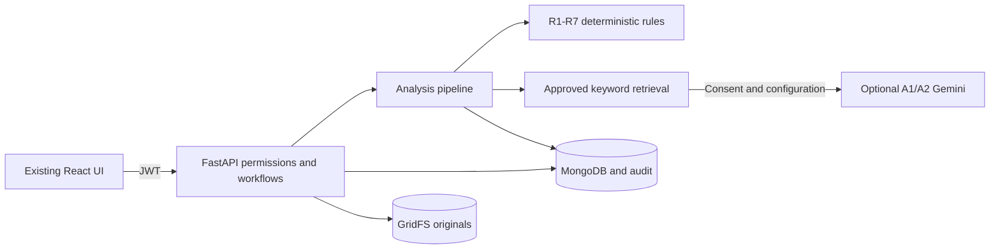

# Architecture

The existing Vite/React application calls one FastAPI service. Maintained async PyMongo stores MongoDB records; AsyncGridFSBucket stores original documents. No second Node backend or production memory store exists.

Collections: `users`, `workspaces`, `memberships`, `knowledge_items`, `submissions`, `content_versions`, `findings`, `reviews`, `audit_events`, `ai_disclosures`; additionally `knowledge_versions` preserves source revisions and `auth_attempts` holds TTL rate-limit counters. Unique email, membership and content-version indexes protect integrity. Every content resource stores workspace ownership.

Workspace membership roles are independent of account role. Creator/Agency reads are owner-restricted. Global Admin status does not bypass tenant checks. The frontend projects the current membership role for navigation; server authorisation is authoritative.

Transactions group mutations and audit writes; write conflicts return 409. Client version/review-request IDs reject stale decisions. Knowledge/source snapshots remain attached to their analysed content versions. Text revisions do not inherit unverifiable document formatting. GridFS uploads happen before submission creation; unused uploads may remain until an operator removes them.

References: [PyMongo Async](https://www.mongodb.com/docs/languages/python/pymongo-driver/current/reference/migration/), [Async GridFS](https://www.mongodb.com/docs/languages/python/pymongo-driver/current/crud/gridfs/), [Google Gen AI SDK](https://github.com/googleapis/python-genai). Semantic retrieval, OCR and distributed background jobs are planned.
