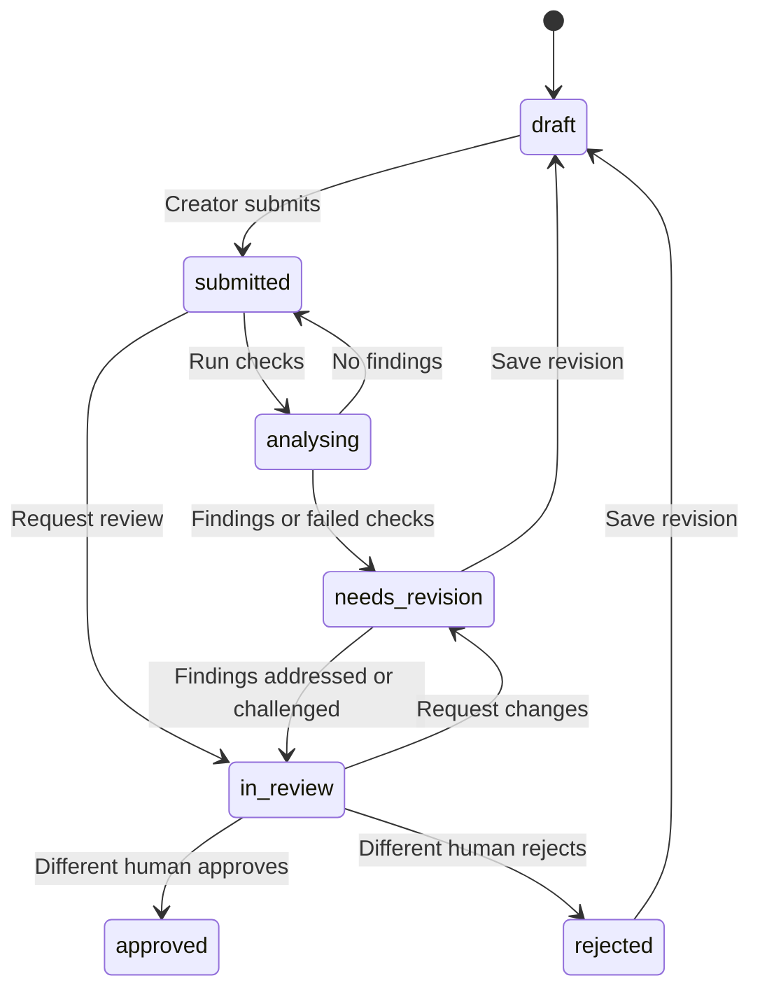

# Human workflow

Only the permitted owner changes drafts/findings. Accept/edit affects working text; saving creates a new version and preserves original files and reports. Dismiss/challenge requires ten characters of reasoning. Review requires the latest saved text to match analysed text and every finding to be addressed or challenged.

Reviewers/Admins see assigned workspace content. A different person makes the decision, with a ten-character comment and explicit acknowledgement for high-severity/challenged/uncertain findings. Content is locked during review. Decisions and audit events commit atomically, with actor/time/content version/knowledge snapshot. Old review tokens and duplicate decisions fail. Rejected or needs-revision content can be revised and resubmitted; approved content is final in this MVP. Approval is not publication.
